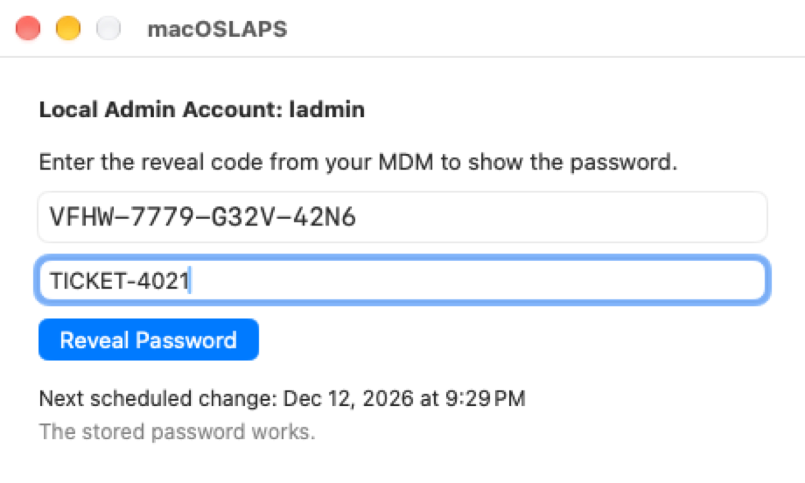
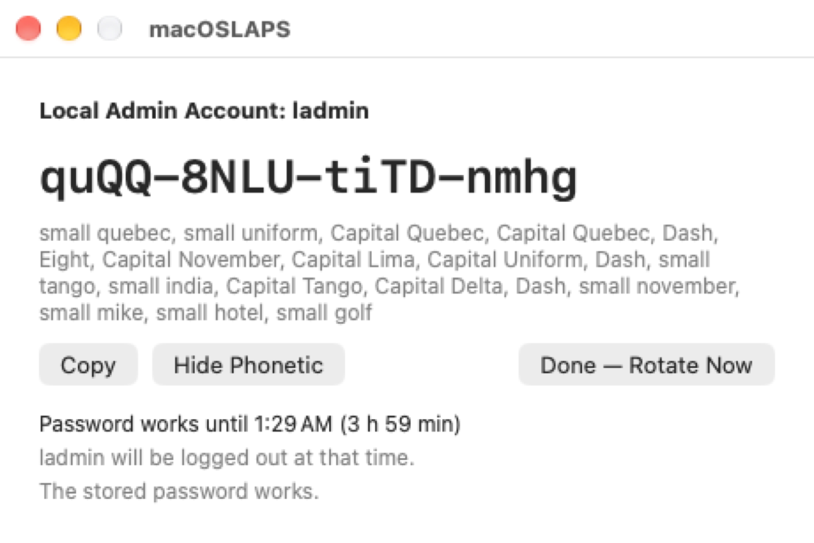
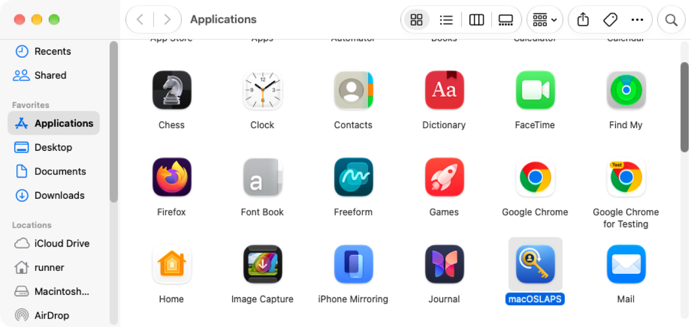

## macOSLAPS 4.0.0 (prerelease)

**This is a prerelease.** Test it on non-production Macs first. Report back in **#laps on MacAdmins Slack** or as a GitHub issue (there's a template). Include the output of `sudo macOSLAPS -status -v` and `sudo macOSLAPS -showConfig` (FirstPass is never printed).

- **Signed and notarized** with Joshua Miller's Developer ID (team 9UYK4F9BSM).
- **Requires macOS 13 or later** (the earlier 4.0 prerelease said 12). Macs on macOS 12 should stay on 3.0.4 or 4.0.0 (845).
- **Version numbers include the build:** `macOSLAPS -version` prints `4.0.0.<build>`, matching the release tag and the pkg name.
- **What has been tested and what hasn't:** see "Tested so far" and "Please test" near the end.

### ⚠️ Before you upgrade: read this first
**1. Admin group protection is on by default and removes admins.**
On its first run, macOSLAPS 4.0 removes every account from the local `admin` group except:
- the managed admin (`LocalAdminAccount`)
- `root`
- the accounts and groups listed in the new `ApprovedAdmins` setting
- the admin your MDM created during Automated Device Enrollment (the Jamf PreStage admin, the Intune ADE admin, the Iru Auto Admin, and so on). macOS records these, and macOSLAPS reads that record (`mdmclient QueryDeviceInformation`, `AutoSetupAdminAccounts`), matching both the account's ID and its short name.

**If your users are admins on purpose, or another tool uses an admin account** (for example the Jamf management account from user-initiated enrollment, which macOS doesn't record, or a support account), set one of these in your profile **before** installing:
- `ApprovedAdmins`: an array of short names, or `group:<name>` for the members of a group, or
- `AdminGroupPolicy report`, which only lists unapproved admins in `-status` and the log.

Safety rails apply whatever the setting:
- macOSLAPS never touches `root` or the managed admin.
- It removes nobody unless the managed admin exists, is an admin, and macOSLAPS has just verified its stored password. A Mac is never left without a working admin.
- It removes only direct members of `admin`. Nested groups are reported, not changed.
- On an MDM-enrolled Mac, if the list of MDM-created admins can't be read, it removes nobody on that run and says why in `-status`.
- With the default `auto`, nobody is removed when an elevation tool is installed (SAP Privileges, Jamf Connect, Admin By Request, Make Me Admin). macOSLAPS reports only. Use `enforce` to remove admins anyway.
- Every removal is logged and listed in `-status` (`demotedAdmins`).

Check before deploying: `sudo macOSLAPS -status -v` lists the admins that would be removed (`unapprovedAdmins`).

**2. New identity, new keychain item, and a one-way migration.**
4.0 drops the Penn State `edu.psu` identifiers. Here is everything that changes on the Mac:

| | 3.x and 4.0.0 (845) | 4.0 (this build) |
|---|---|---|
| Program | `/usr/local/laps/macOSLAPS` | `/Applications/macOSLAPS.app` (the old path is a symlink to it through 4.x) |
| Code-signing identifier | `edu.psu.macOSLAPS` | `com.joshua-d-miller.macoslaps`; a small migration helper inside the app keeps `edu.psu.macOSLAPS` |
| Password in the System keychain | `macOSLAPS` (and `macOSLAPS-pending` in earlier 4.0 test builds) | `com.joshua-d-miller.macoslaps` (and `.pending`; `.reveal` holds the device-mode code) |
| Settings domain | `edu.psu.macoslaps` | `com.joshua-d-miller.macoslaps` (the old domain is still read through 4.x) |
| LaunchDaemons | `edu.psu.macoslaps-check` | `com.joshua-d-miller.macoslaps-check`, `com.joshua-d-miller.macoslaps-service` |
| LaunchAgent | none | `com.joshua-d-miller.macoslaps.agent` (menu bar countdown) |
| Package receipts | `edu.psu.macOSLAPS`, `edu.psu.macOSLAPS-check` | `com.joshua-d-miller.macoslaps`, `com.joshua-d-miller.macoslaps-check` (the old ones are forgotten) |
| Log | `/Library/Logs/macOSLAPS.log` | `/Library/Application Support/macOSLAPS/Logs/macOSLAPS.log`, with a symlink at the old path; also the unified log |
| 3.x plaintext files | `/var/root/Library/Application Support/macOSLAPS-password` and `-expiration` | deleted without being read |

**How the migration works.** The old keychain item only trusts the `edu.psu.macOSLAPS` signature, so on its first run 4.0 uses the helper inside the app to read it. Then it:
1. checks that the password actually works for the account;
2. saves it in the new item, keeping its original creation date (so the next rotation is still due on schedule);
3. overwrites the old item, then deletes it;
4. deletes the old `-getPassword` export and the 3.x plaintext files, without reading them.

If no stored password works, nothing is changed. `-status` reports `"migration": "required"` and macOSLAPS stops rotating until you give it the current password: `printf '%s\n' "$pw" | macOSLAPS -firstPass - -initialize` (or `-firstPass <current password>`). Only the signed release can migrate: a copy you build or sign yourself can't read the old item and reports "migration required".

**What to watch out for**
- **Scripts or extension attributes that read the keychain directly** (`security find-generic-password -s macOSLAPS …`) stop finding anything after migration. Use `macOSLAPS -escrow` or `-status`, or this release's scripts.
- **Smart groups, patch definitions, Munki `installs` items or compliance checks** keyed on the `edu.psu.macOSLAPS` receipt or on `/usr/local/laps/macOSLAPS` need the new receipt or the app (`CFBundleShortVersionString` 4.0.0, `CFBundleVersion` = the build).
- **Managed Login Items or PPPC profiles** that name `edu.psu.macoslaps-check` or `edu.psu.macOSLAPS`: switch them to team identifier `9UYK4F9BSM`, which covers both LaunchDaemons and the LaunchAgent. System Settings now shows "macOSLAPS" for them rather than a developer name (#75).
- **Profiles:** move your settings to `com.joshua-d-miller.macoslaps` when you can. Keys are unchanged, and the old domain keeps working with a warning.

**Rolling back.** Older versions can't read the new item, so there is no in-place downgrade. To roll back:
1. Collect the current password (`-escrow`, or your MDM's inventory).
2. Run `sudo macOSLAPS -uninstall`. This keeps the stored password and stops two LaunchDaemons from running side by side.
3. Install 3.0.4 or 4.0.0 (845).
4. Set `FirstPass` to that password in your profile and run `-resetPassword`.

**3. Other changes that may affect you**
- **`LocalAdminAccount` created by your MDM.** If macOSLAPS manages the admin your MDM created during enrollment, the MDM can change that password too (its own LAPS). macOSLAPS warns once a day; if your MDM's LAPS is on for the account, let one of them own it. `AllowMDMManagedAccount false` makes macOSLAPS refuse instead.
- **An outside password change stops rotation.** If the stored password stops working because something else changed it (another LAPS tool, the MDM, or a technician), macOSLAPS no longer resets the account, even when the account has no secureToken. It stops rotating and reports `externalChange` in `-status`. To manage the account again, run `macOSLAPS -firstPass <current password> -resetPassword` (or `-initialize`).
- **Paths:** `/etc/paths.d/laps` now points into the app, so `macOSLAPS` works from any shell. `/usr/local/laps/macOSLAPS` logs a deprecation notice and is removed in 5.0. Update scripts that use the full path.
- **App-only package over 845:** the `-Binary-` pkg alone leaves the old `edu.psu.macoslaps-check` LaunchDaemon running through the `/usr/local/laps` symlink. It works and logs the deprecation notice. Install the full or `-LD-` pkg to switch to the new LaunchDaemons.
- **Replace your copies of the scripts** in `MDM Scripts/`, `jamf Extension Attributes/` and `integrations/` with this release's. They use the new paths, and the earlier ones mishandled passwords containing a backslash. The combined Jamf extension attribute was renamed `Password and Expiration Combined.zsh`; the colon in the old name broke checkouts on Windows.

### Getting the password: four ways
| | Setting | Where the password is | How IT gets it |
|---|---|---|---|
| **Escrow** (default) | `RetrievalMode escrow` | On the Mac and in your MDM's inventory, in plain text | The inventory attribute filled by `macOSLAPS -escrow` |
| **Encrypted escrow (CMS)** | `RetrievalMode escrow` + `EscrowCertificates` | On the Mac and in your MDM's inventory, **encrypted**: the MDM, and anyone who can read inventory, never sees it | Decrypt the inventory value with your private key |
| **Device mode** | `RetrievalMode device` | **Only on the Mac.** Your MDM holds a reveal code instead | A technician enters the code on the Mac |
| **Active Directory** | `Method AD` | On the computer object | ADUC, `Get-LapsADPassword`, or your LAPS UI |

**Encrypted escrow (CMS)** keeps the password out of your MDM's database in readable form, while your MDM still holds a copy for when the Mac can't be reached.
1. Create an RSA certificate for each admin or team (on Windows: `New-SelfSignedCertificate -Type DocumentEncryptionCert -Subject "CN=macOSLAPS Escrow"`; the certificate needs the Document Encryption EKU). Keep the private keys with your admins, ideally on a smart card or YubiKey, plus an offline recovery certificate.
2. Put the public certificates in `EscrowCertificates` (PEM text or base64 DER, one per array item). Every listed certificate can decrypt.
3. `macOSLAPS -escrow` then prints a `-----BEGIN CMS-----` block (AES-256, about 1 KB per certificate) instead of the password. Store it in an inventory attribute that keeps line breaks.
4. To read it, copy the whole block into `escrow.txt` and run:
   - Windows: `Unprotect-CmsMessage -Path .\escrow.txt`
   - macOS: `sed '1d;$d' escrow.txt | base64 -D > escrow.der && security cms -D -i escrow.der`
   - OpenSSL: `openssl cms -decrypt -inform PEM -in escrow.txt -recip cert.pem -inkey key.pem`

It fails closed: if `EscrowCertificates` is set but none of them is usable, `-escrow` prints an error and no password. Device mode can use the same certificates to encrypt the reveal code. Details and MDM-specific scripts: `integrations/README.md`.

**Device mode, step by step**
1. Your MDM's inventory runs `macOSLAPS -escrow` and stores the Mac's **reveal code** (16 characters like `ABCD-EFGH-JKMN-PQRS`, CMS-encrypted when `EscrowCertificates` is set). The password itself never leaves the Mac.
2. A technician looks the code up in the MDM.
3. On the Mac, signed in as the user (no admin rights needed), they open **macOSLAPS** from Applications, type the code and an optional reason or ticket number, and get the password in large type, with a phonetic spelling for reading it over the phone ("Capital Alfa, small bravo, Seven…"). **Copy** clears the clipboard after 60 seconds.
4. They use it to elevate: an authentication prompt, System Settings, an installer.
5. A menu bar item counts down the time left (`ladmin | 3:42`, orange in the last 15 minutes). Notifications go out when the password is revealed, 15 minutes before it changes, and when it has changed. **Done — Rotate Now** ends the grace period early. The same code keeps working until then, so re-elevating needs no new code.
6. When `RevealGracePeriod` ends (default 4 hours, 0–24), the managed admin is logged out if it's signed in (`RevealAction rotateAndLogout`, the default; `rotate` only rotates), the password rotates, and a new code goes to the MDM at its next inventory.

**What the technician sees** (captured by CI on a macOS 27 runner; the password belongs to a throwaway VM):

| 1. Code and reason entered | 2. Revealed, with phonetic spelling |
|---|---|
|  |  |

The menu bar countdown: 

From a script or Terminal: `macOSLAPS -reveal` asks for the code (or reads it from a pipe: `printf '%s\n' "$code" | macOSLAPS -reveal`). The code is never accepted on the command line, where other processes could see it.

Device mode also:
- locks reveals after five wrong codes, until the next rotation;
- records every reveal with the signed-in user and the reason, and shows `revealedAt` and `rotatesAt` in `-status`;
- with `Method AD`, `ADRevealCode true` writes the code to AD instead of the password;
- refuses `-getPassword`, and staged rotation doesn't apply.

**It requires a FileVault personal recovery key escrow profile**, because a reveal code can't unlock FileVault or the login window. `-status -v` warns when the profile is missing. The fallback for a locked-out Mac is switching it to escrow mode by profile.

The window and menu bar talk to a root service (`com.joshua-d-miller.macoslaps-service`) over XPC, and both sides check the other's code signature (team 9UYK4F9BSM). The password is never written to a file or passed on a command line. An MDM Notifications payload for `com.joshua-d-miller.macoslaps` can pre-approve the notifications.

### What's new since the last prerelease
- **The app.** macOSLAPS is now an app bundle at `/Applications/macOSLAPS.app`. The command line works as before. It has its own icon: a gold key with the account in its bow, circled by a rotation arrow. 
- **Packages:** three, as before: the full pkg, `-Binary-` (app only) and `-LD-` (LaunchDaemons and the LaunchAgent). The installer choices `installer_choice_1` and `installer_choice_2` are unchanged, so InstallerChoices.xml files keep working.
- **`-uninstall`** removes macOSLAPS but keeps the stored password. `-uninstall -purge` also deletes the stored passwords, the state and the logs (make sure your MDM has the password first). The script it runs is in the app too, for MDMs that run scripts: `/Applications/macOSLAPS.app/Contents/Resources/uninstall.sh [--purge]`.
- **Device mode, the reveal window and the menu bar countdown** (above).
- **`-expireIn <time>`** (escrow and device mode): change the password at a set time, e.g. `-expireIn 4h`, `2h30m`, or `0` for the next run. Use it after handing out the password in escrow mode. The menu bar countdown shows it too. Deadlines are met on time, even between scheduled runs.
- **Admin group protection** and **MDM-created admin detection** (above).
- **`-firstPass -`** reads the password from a prompt or a pipe (`printf '%s\n' "$pw" | macOSLAPS -firstPass - -resetPassword`), so it never appears in the process list. A password on the command line still works but logs a warning.
- **`-status`** adds:
  - `migration`, `migratedAt`, `migratedFrom`
  - `adminGroupPolicy`, `unapprovedAdmins`, `elevationTool`, `demotedAdmins`
  - `retrievalMode`, `revealCodeSet`, `revealFailures`, `revealLocked`, `revealCodeCollected`, `revealedAt`, `rotatesAt`, `rotateReason`
  - `externalChange`, `externalChangeReason`
  - `mdmAdmins`, `mdmAdminList`, `localAdminIsMDMAccount`
- **Profile manifests:** `Profile Manifests/` has a Jamf Pro custom schema and an iMazing Profile Editor manifest covering every setting, with defaults and allowed values. The example plist includes the new settings.
- **Logging:** messages also go to the unified log (`log show --predicate 'subsystem == "com.joshua-d-miller.macoslaps"'`), and the log file rotates at 5 MB, keeping four old copies.

### Still in this build from the previous prerelease
- **Generated passwords are correct** (length, requirements, exclusions; #121, #109, #93, #118).
- **Safer rotation:** macOSLAPS changes the password, verifies it, then stores it, and reverts on failure (#110).
  - secureToken handling fails closed.
  - Stop signals are held off during a change, and only one rotation runs at a time.
- **`-firstPass <password>`** works in any position.
- **Staged rotation** (`StagedRotation auto|on|off`): the MDM collects the next password before the account uses it.
- **Settings are resolved per key** across the new and old domains; see `-showConfig`. Wrong value types no longer crash macOSLAPS (#86).
- **Other settings and commands:**
  - `-initialize` (#88);
  - `InventoryHook`;
  - `PasswordStyle readable`;
  - `ADSchema legacy|windowsLAPS|both` (experimental; #102, building on #103 by TobiasSplinter).
- **Ready-made scripts** for Jamf, Intune, Workspace ONE and other MDMs are in `integrations/`. Henri Kovanen's MDM install and inventory scripts are in `MDM Scripts/`, updated for the app.

### Tested so far
Every build runs these on GitHub's macOS runners before it can be published. All passed on this build.

<b>Smoke test</b> on macOS 15 (Apple silicon), 15 (Intel), 26 and 27, about 205 checks each

- Install layout: the app, the symlink, `/etc/paths.d/laps`, both LaunchDaemons, the LaunchAgent, receipts, the app icon and strings; Login Items attributed to macOSLAPS.app.
- Rotation: first rotation with FirstPass, forced rotation, 25 rotations through the password generator, the old password stops working.
- Safety: a simulated secureToken account requires the old password; secureToken detection fails closed; stop signals mid-change are ignored; two runs at once don't interleave; an outside password change stops rotation without touching the account; `-firstPass` and `-firstPass -`.
- Settings: new and old domains resolved per key.
- `-status`, `-status -v`, `-escrow` in plain text and CMS, `-initialize`, staged rotation, the custom inventory hook, `PasswordStyle readable`.
- Device mode: reveal codes, wrong codes, the five-try lockout, the grace deadline, `-expireIn`, the deadline met between scheduled runs, codes refused on the command line.
- The privileged service: a standard user reveals through XPC, an unsigned copy is refused, rotate-now requests (including stale ones, which are ignored).
- Admin group protection: unapproved admins removed, approved ones and groups kept, report mode, MDM-created admin list read.
- Logs: location, symlink, rotation, unified log.
- `-uninstall` keeps the password; `uninstall.sh --purge` removes everything.

<b>Upgrade from 4.0.0 (845)</b> on macOS 15, 26 and 27, about 58 checks each

- 845 installed and rotated, then this build installed over it.
- The password migrated from 845's keychain item with its creation date; the old item and export deleted; old LaunchDaemon and receipts removed.
- "Migration required" and recovery with `-firstPass -initialize`; 3.x plaintext files never used.
- Admins' existing scripts and the Jamf extension attributes still work, including with a password full of shell and JSON special characters.
- The `-Binary-` and `-LD-` packages.
- The old log kept as `macOSLAPS-3x.log`.

<b>Upgrade from 3.0.4</b> on macOS 15, 26 and 27

- 3.0.4 installed and rotated, then this build installed over it.
- The password migrated from 3.0.4's keychain item; plaintext files, LaunchDaemon and receipts removed; rotation works afterwards and invalidates 3.0.4's password.

<b>The window and menu bar, driven like a technician would</b> on macOS 26 and 27

- The app opened as the signed-in standard user; the code and a ticket number typed into the window through Accessibility; **Reveal Password** pressed.
- The reveal recorded with the user and the ticket, and the grace period started; **Show Phonetic** pressed.
- The menu bar countdown appeared; the icon checked in Finder; the escrow-mode window; a reveal from Terminal through a pipe.
- Every step is captured as a screenshot (the ones above come from this test).

<b>Also on every build</b>

- About 23,000 password-generator checks, including 10,000 random policies.
- Unit tests for the shell helper and for reading the MDM-created admin list (including real output from a Mac with a Jamf PreStage admin).
- The CMS escrow from the smoke test decrypted on Windows with `Unprotect-CmsMessage` in PowerShell 7 and Windows PowerShell 5.1.
- Signing and notarization of the app and all three pkgs; style checks; every setting present in the profile manifests.

### Please test
These need real hardware, a real directory or a real MDM, which CI doesn't have. Tell us your macOS version (13 through 27), Intel or Apple silicon, your MDM, your Method, and your RetrievalMode.

1. **secureToken accounts, especially on macOS 26 (#120, #96).** CI can't create a real secureToken. Test the first rotation with FirstPass, a later rotation, then logging in and **unlocking FileVault** with the new password.
2. **Admin group protection on your fleet.** Set `ApprovedAdmins` the way you would in production, then compare `-status -v` with what you expect.
   - Does `-status` list your MDM's enrollment admin under `mdmAdmins` (Jamf PreStage admin, Intune ADE admin, Iru Auto Admin)? If not, please send the `AutoSetupAdminAccounts` block from `sudo /usr/libexec/mdmclient QueryDeviceInformation`.
   - Is the Jamf management account listed as unapproved? (Expected until you add it to `ApprovedAdmins`.)
   - Is your elevation tool detected?
3. **Migration on real Macs** from 3.0.4, 4.0.0 (845) and older 3.x builds, including AD-mode Macs and Macs with a staged pending password.
4. **Device mode end to end:** the MDM collects the code, a standard user reveals the password in the app, elevation, the menu bar countdown, the 15-minute notification, and the forced logout and rotation at the deadline, with and without the admin signed in.
5. **The app:** VoiceOver, the phonetic spelling over the phone, the icon in the Dock and notifications, and the menu bar item's menu (CI shows the countdown but can't open the menu).
6. **Encrypted escrow in your MDM:** does the inventory attribute keep the whole CMS block with its line breaks? Smart card or YubiKey decryption with `security cms`.
7. **Active Directory on a real domain** with each `ADSchema`, and `ADRevealCode` in device mode.
8. **Settings delivered as configuration profiles**, split across both domains (CI can only test files in /Library/Preferences), and the profile manifests imported into Jamf Pro or iMazing Profile Editor.
9. **Your packages and InstallerChoices.xml,** including the `-Binary-` pkg alone over 845, and the Login Items notification text and your Managed Login Items rule (#75).
10. **Staged rotation with your MDM's hook,** including `InventoryHookConfirms` with your MDM's agent command.
11. **Uninstall:** `-uninstall`, then `-uninstall -purge`. Is anything left behind?
12. **macOS 13 and 14,** which have no CI runners.

### Known issues and limitations
- **#120 is still open,** and **#96** is unconfirmed: "Unable to change password using FirstPass" on secureToken accounts. See test 1.
- **The Jamf management account** (user-initiated enrollment) is not detected: macOS has no record of it. List it in `ApprovedAdmins`. MDM-created admins from Automated Device Enrollment are detected.
- **Reveals happen after login.** Device mode can't reveal the password at the FileVault unlock screen or the login window. Escrow the FileVault recovery key.
- **A promoted admin is caught on the next run** (every 90 minutes), not the moment it happens.
- **The window is English only.** The strings are in `Resources/en.lproj/Localizable.strings` for translators.
- **`ADSchema windowsLAPS` and `both` are experimental.** CI has not run macOSLAPS in AD mode against a domain.
- **Windows LAPS encrypted passwords** (`msLAPS-EncryptedPassword`) are not supported.
- **Entra ID** has no supported way for non-Windows devices to store LAPS passwords. With Intune, use custom attributes with `-escrow` (ideally encrypted), or device mode.
- **`PasswordStyle passphrase`** falls back to `readable` for now.
- **`-getPassword`** is deprecated and will be removed in 5.0. Use `-escrow`.
- **The 3.0.4 and 4.0.0 (845) pkgs will be re-signed** before Apple retires the old signing authority on Feb 1, 2027 (contents unchanged, notarized). Their SHA-256 checksums will change.

### Thanks
macOSLAPS started at The Pennsylvania State University. Thank you to Penn State for the start, and to everyone who has helped since.

- **Code over the years:** @neilmartin83, @apizz, @MagerValp, @discentem, @dechkovanen and @bartreardon.
- **In this release:** Henri Kovanen for the MDM install and inventory scripts; @TobiasSplinter for the Windows LAPS schema work (#102, #103); @Melvin-P-NL for the password-length fix (#121); and a former Penn State colleague for the real `AutoSetupAdminAccounts` output that the MDM-created admin detection is tested against.
- **The reports that shaped 4.0:** @rougegoat (#75), @tlcarpenter (#86), @staze (#88), @brianhm (#92, #93), @GabrielKemp (#96), @mhu4711 (#104), @mruepp (#106), @FocusTechnologiesAdmin (#109), @AndreaDelmonte (#110), @dmmueller (#112), @BenjaminHoegh (#117, #118), @wakco (#119) and @security-josh (#120). Device mode, `-expireIn`, encrypted escrow and the safer rotation all started as one of these issues.
- **The #laps channel on MacAdmins Slack,** for years of questions, testing and patience. Please keep it coming with this prerelease.
