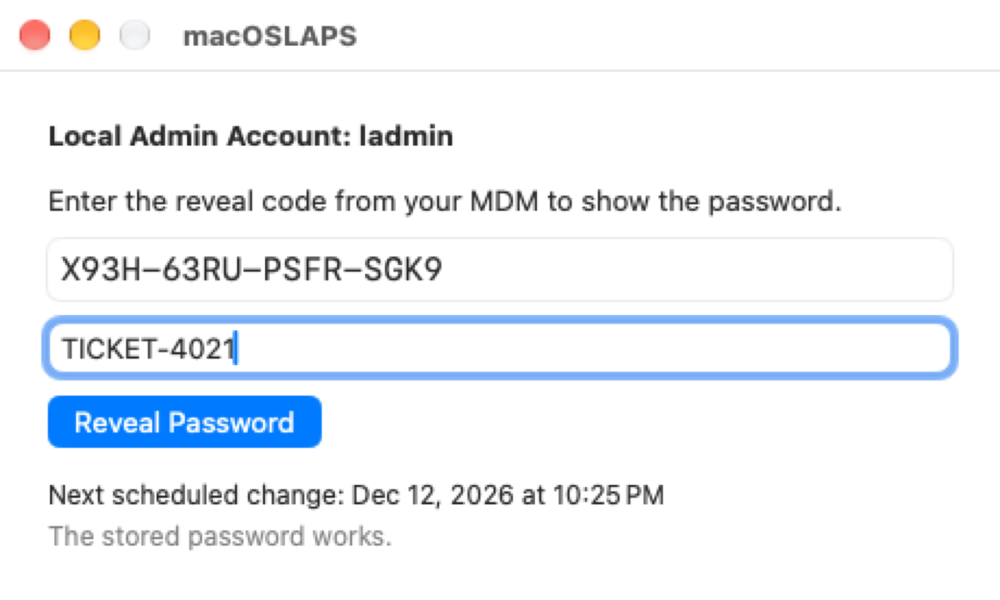
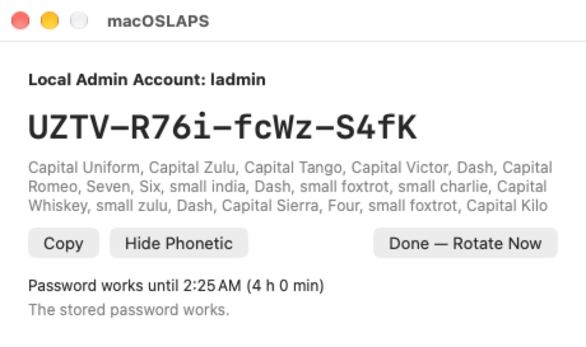

&nbsp;&nbsp;&nbsp;&nbsp;

### macOSLAPS (Local Administrator Password Solution)
macOSLAPS rotates the password of a local administrator account on your Macs to a random value, on a schedule, and keeps it where IT can get it:
- **Escrow:** your MDM collects the password with `macOSLAPS -escrow`, in plain text or encrypted to your admins' certificates (CMS).
- **Device mode:** your MDM collects a reveal code instead. A technician enters it on the Mac, in macOSLAPS.app with no admin rights needed, to see the password, which changes again a few hours later.
- **Active Directory:** the password goes on the computer object (legacy LAPS or Windows LAPS attributes).

It also keeps the admin group to the accounts you approve, and works with any MDM: Jamf Pro, Intune, Workspace ONE, Iru (Kandji), Mosyle and others. Since 4.0 it installs as `/Applications/macOSLAPS.app` and needs macOS 13 or later.

  
  

### Documentation
**[joshua-d-miller.com/macOSLAPS](https://joshua-d-miller.com/macOSLAPS/)** documents 4.0:

| | |
|---|---|
| [Get started](https://joshua-d-miller.com/macOSLAPS/getting-started/) | Set up macOSLAPS with your MDM |
| [Upgrading from 3.x](https://joshua-d-miller.com/macOSLAPS/upgrading/) | The new identity, the keychain migration and what to watch for. **Read this before upgrading.** |
| [Getting the password](https://joshua-d-miller.com/macOSLAPS/retrieval/) | Escrow, encrypted escrow, device mode and Active Directory |
| [Admin group protection](https://joshua-d-miller.com/macOSLAPS/admin-group/) | On by default in 4.0: who stays admin |
| [Settings reference](https://joshua-d-miller.com/macOSLAPS/settings/) | Every key and its default |
| [Testing 4.0](https://joshua-d-miller.com/macOSLAPS/testing/) | What CI tests on every build, and what needs your Macs |

**macOSLAPS 3.x** is documented on the [wiki](https://github.com/joshua-d-miller/macOSLAPS/wiki), which is kept as it is for 3.x users.

The site is built from [`docs/`](docs) and published by GitHub Actions. To preview it locally: `pip install zensical && zensical serve`.

### In this repository
| | |
|---|---|
| [`Profile Manifests/`](Profile%20Manifests) | Jamf Pro custom schema and iMazing Profile Editor manifest for every setting |
| [`PLIST Example/`](PLIST%20Example) | An example settings file |
| [`integrations/`](integrations) | Escrow and status scripts for Jamf Pro, Intune, Workspace ONE and other MDMs |
| [`jamf Extension Attributes/`](jamf%20Extension%20Attributes), [`MDM Scripts/`](MDM%20Scripts) | More Jamf extension attributes, and install and reporting scripts for any MDM |
| [`.github/release-notes/`](.github/release-notes) | Release notes |

### Preference domain
Starting with 4.0, configuration profiles should use the preference domain (PayloadType) `com.joshua-d-miller.macoslaps`. The keys are unchanged. Profiles using the original `edu.psu.macoslaps` domain continue to work throughout 4.x and log a deprecation warning. Run `sudo macOSLAPS -showConfig` to see which settings are in effect and where they came from.

### Feedback and Questions
If you have questions you can contact me or the vibrant and friendly community in the [#laps](https://macadmins.slack.com/archives/C68F4NLFL) channel on **[MacAdmins Slack](https://macadmins.org)**, or open an [issue](https://github.com/joshua-d-miller/macOSLAPS/issues).

### History
macOSLAPS was originally created while I was at The Pennsylvania State University, which is where the `edu.psu` identifiers come from. Thank you to Penn State for the start. The project is now maintained independently. Everyone who has contributed is thanked on the [credits page](https://joshua-d-miller.com/macOSLAPS/credits/).
