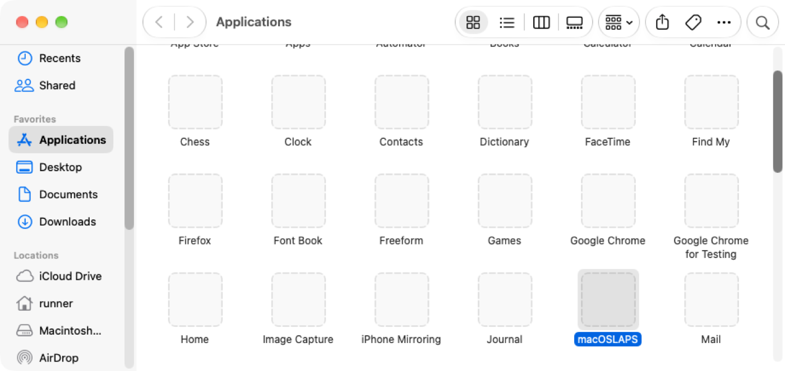

# Get started

This page sets up macOSLAPS from scratch with an MDM, the most common setup. Upgrading Macs that already run macOSLAPS? Read [Upgrading from 3.x](upgrading.md) first.

## 1. Choose the account and how IT gets the password

macOSLAPS manages **one** local admin account, set by `LocalAdminAccount` (default `admin`). Create it the way you do today, for example with your MDM's enrollment settings, a script, or a package.

!!! info "One account, one owner"
    Don't point macOSLAPS at an account your MDM's own LAPS feature already rotates, such as Jamf Pro's LAPS for the management account or the PreStage admin. Two tools changing one password will lock each other out. macOSLAPS warns when the account was created by your MDM (see [`AllowMDMManagedAccount`](settings.md#admin-group-protection)) and stops rotating if something else changes the password.

Then decide how IT gets the password. Most people start with **escrow** and add certificates later. See [Getting the password](retrieval/index.md) to compare the options.

## 2. Make a configuration profile

Settings go in a configuration profile for the preference domain **`com.joshua-d-miller.macoslaps`**. For an MDM setup you need at least:

```xml
<key>Method</key>
<string>Local</string>              <!-- the built-in default is AD -->
<key>LocalAdminAccount</key>
<string>ladmin</string>
<key>ApprovedAdmins</key>
<array>
    <string>group:helpdesk</string>  <!-- anyone else who should stay admin -->
</array>
```

!!! danger "Set `Method` and check `ApprovedAdmins` before you deploy"
    - The built-in default for `Method` is `AD`, from macOSLAPS's Active Directory origins. MDM setups must set **`Local`**.
    - **Admin group protection is on by default.** On its first run macOSLAPS removes every admin except the managed account, `root`, the accounts in `ApprovedAdmins` and the admin your MDM created during enrollment. If your users are admins on purpose, add them, or set `AdminGroupPolicy` to `report`. Read [Admin group protection](admin-group.md).

Tools for building the profile:

- **Jamf Pro:** upload the [custom schema](https://github.com/joshua-d-miller/macOSLAPS/blob/4.0.0.950/Profile%20Manifests/com.joshua-d-miller.macoslaps.json) under Application & Custom Settings.
- **iMazing Profile Editor** and other editors: the [ProfileManifests manifest](https://github.com/joshua-d-miller/macOSLAPS/blob/4.0.0.950/Profile%20Manifests/com.joshua-d-miller.macoslaps.plist).
- **Anything else:** start from the [example plist](https://github.com/joshua-d-miller/macOSLAPS/blob/4.0.0.950/PLIST%20Example/com.joshua-d-miller.macoslaps.plist).

Every key is described in the [settings reference](settings.md).

### If the account has a secureToken

If the account already exists with a password you know, and it has a secureToken (most admins created by Setup Assistant or your MDM do), macOSLAPS needs that password **once** for its first rotation. Set `FirstPass` to it, and remove the key once Macs have rotated. Or run the first rotation from your MDM, which keeps the password out of the profile:

```bash
printf '%s\n' "$current_password" | macOSLAPS -firstPass - -resetPassword
```

See [secureToken and FileVault](secure-token.md) for why.

## 3. Allow the background items (recommended)

macOSLAPS installs two LaunchDaemons and a LaunchAgent. Without a profile, macOS shows users a "Background Items Added" notification. A **Managed Login Items** (Service Management) profile with team identifier **`9UYK4F9BSM`** covers all three and keeps users from turning them off.

## 4. Install the package

Download the pkg from [Releases](https://github.com/joshua-d-miller/macOSLAPS/releases) and deploy it with your MDM. There are three:

| Package | Installs | Use it when |
|---|---|---|
| `macOSLAPS-4.0.0.<build>.pkg` | Everything | Almost always |
| `macOSLAPS-Binary-4.0.0.<build>.pkg` | Only `/Applications/macOSLAPS.app` | You manage the LaunchDaemons yourself |
| `macOSLAPS-LD-4.0.0.<build>.pkg` | Only the LaunchDaemons and LaunchAgent | The app is already installed |

Install the profile **before** the package, so the first run uses your settings. The package installs:

| Item | Where |
|---|---|
| The app (command line included) | `/Applications/macOSLAPS.app` |
| The command on your `PATH` | `/etc/paths.d/laps` |
| Legacy path (removed in 5.0) | `/usr/local/laps/macOSLAPS` → the app |
| Rotation check, every 90 minutes | `/Library/LaunchDaemons/com.joshua-d-miller.macoslaps-check.plist` |
| Service for the window and menu bar | `/Library/LaunchDaemons/com.joshua-d-miller.macoslaps-service.plist` |
| Menu bar countdown | `/Library/LaunchAgents/com.joshua-d-miller.macoslaps.agent.plist` |

Once installed, macOSLAPS appears in Applications:

{ width=560 }

Henri Kovanen's [MDM install script](https://github.com/joshua-d-miller/macOSLAPS/blob/4.0.0.950/MDM%20Scripts/macoslaps4-mdm-install-script.sh) installs, updates or uninstalls macOSLAPS from your MDM, and can also create the managed admin. Review its settings before you use it.

## 5. Collect the password in your MDM

Add an inventory attribute that runs `macOSLAPS -escrow` (an extension attribute in Jamf Pro, a custom attribute in Intune, a sensor in Workspace ONE). Ready-made scripts for each are described in [MDM setup](mdm.md). Add a second one for `macOSLAPS -status`, which catches broken Macs before you need their password.

## 6. Check a Mac

On a test Mac, after the profile and package are installed:

```bash
sudo macOSLAPS -showConfig   # the settings in effect and where each came from
sudo macOSLAPS -status -v    # a readable checklist: account, secureToken, stored password, admins
sudo macOSLAPS -escrow       # what your MDM will collect
```

`-status -v` should show the account, a stored password that verifies, and no line saying "Admins not in ApprovedAdmins" that lists someone you meant to keep. The log is at `/Library/Logs/macOSLAPS.log`. If something's wrong, see [Troubleshooting](troubleshooting.md).
