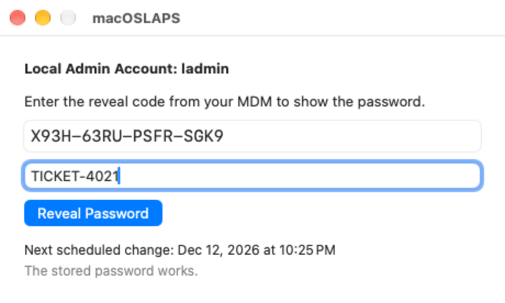
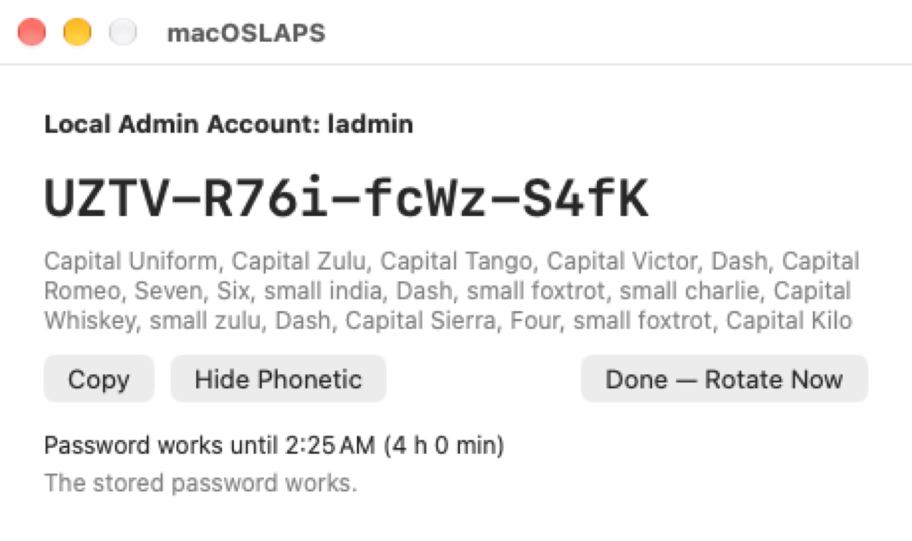

# macOSLAPS

{ align=right width=120 }

**macOSLAPS rotates the password of a local administrator account on your Macs to a random value, on a schedule, and keeps it where IT can get it.** It works with any MDM (Jamf Pro, Intune, Workspace ONE, Iru, Mosyle and others) and with Active Directory.

!!! warning "4.0 is a prerelease"
    These pages describe **macOSLAPS 4.0**, which is in prerelease testing. Try it on non-production Macs first, and read [Upgrading from 3.x](upgrading.md) before you install it over an earlier version. Feedback is welcome in **#laps** on [MacAdmins Slack](https://macadmins.org) or as a [GitHub issue](https://github.com/joshua-d-miller/macOSLAPS/issues). The [testing guide](testing.md) lists what most needs testing.

    Running macOSLAPS 3.x? Its documentation stays on the [wiki](legacy.md).

## What it does

- **Rotates the password** of one local admin account every `DaysTillExpiration` days (60 by default), and whenever you ask. It changes the password, checks that the new one works, then stores it. If anything fails, it puts the old one back.
- **Keeps the password where IT can get it,** in one of [four ways](retrieval/index.md):
    - your MDM's inventory, in plain text or encrypted to your admins' certificates;
    - only on the Mac, revealed by a technician with a one-time code from your MDM ([device mode](retrieval/device-mode.md));
    - the computer object in Active Directory.
- **Keeps the admin group clean.** By default it removes admins you haven't approved, with safety rails so a Mac is never left without a working admin. See [Admin group protection](admin-group.md).
- **Handles secureToken and FileVault accounts** safely. See [secureToken and FileVault](secure-token.md).

## Device mode at a glance

A technician at the Mac types the reveal code from your MDM. No admin rights are needed.

The password keeps working for a few hours, counted down in the menu bar, and then changes:

{ width=400 }

*These screenshots are taken automatically by CI on GitHub's macOS 26 and 27 runners, each time macOSLAPS is built.*

## Where to start

| If you are… | Read |
|---|---|
| New to macOSLAPS | [Get started](getting-started.md) |
| Upgrading from 3.x or 4.0.0 (845) | [Upgrading from 3.x](upgrading.md) |
| Choosing how IT gets the password | [Getting the password](retrieval/index.md) |
| Setting up your MDM | [MDM setup](mdm.md) and the [settings reference](settings.md) |
| Testing the prerelease | [Testing 4.0](testing.md) |
| Fixing a Mac | [Troubleshooting](troubleshooting.md) |

## Requirements

- **macOS 13 or later**, Intel or Apple silicon. Macs on macOS 12 can stay on 3.0.4; see [Legacy](legacy.md).
- **One local admin account** for macOSLAPS to manage. It can have a secureToken.
- **An MDM** to deliver the settings and collect the password or reveal code, **or Active Directory** with a writable domain controller.

## Download

Packages are on the [Releases page](https://github.com/joshua-d-miller/macOSLAPS/releases). Every package is signed and notarized with Joshua Miller's Developer ID (team `9UYK4F9BSM`).
