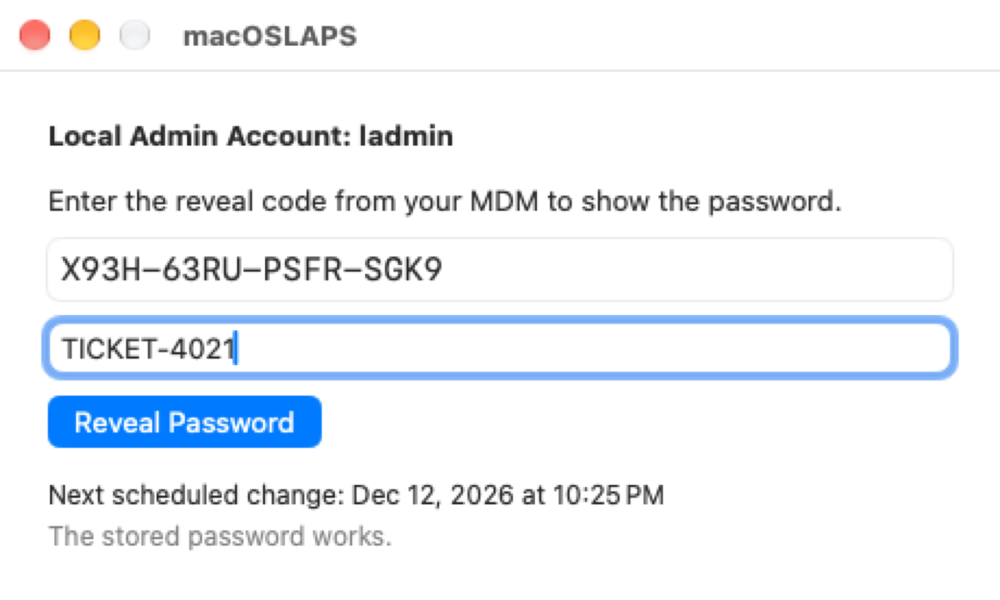
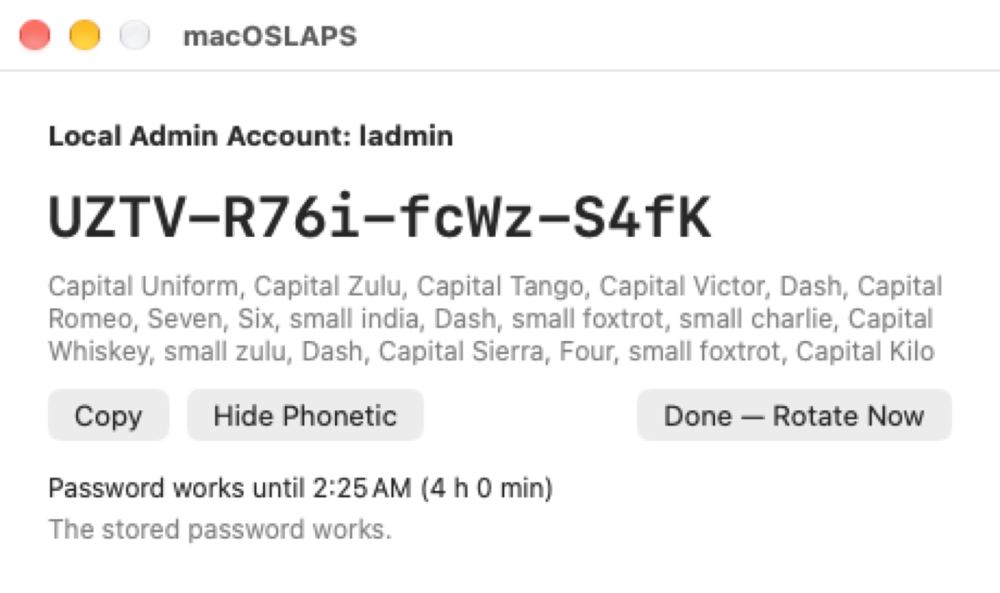
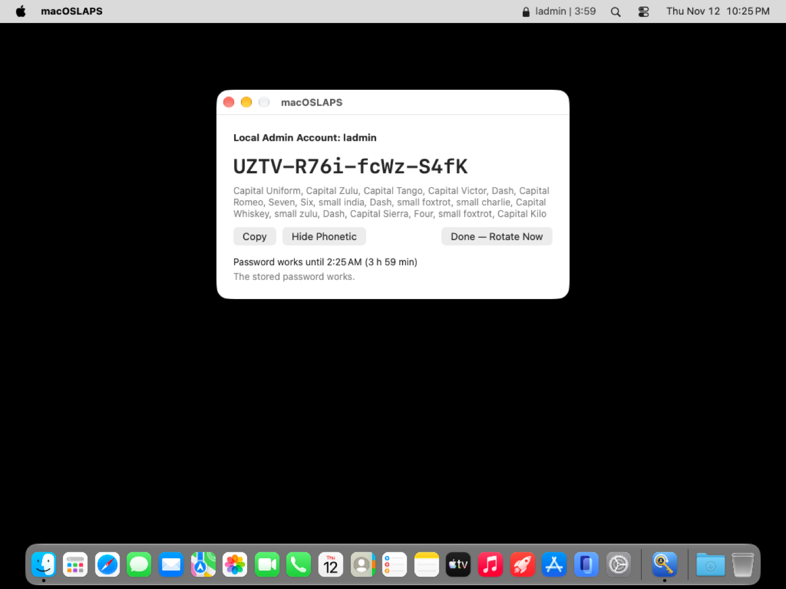

# Device mode

In device mode the password **never leaves the Mac**. Your MDM collects a **reveal code** instead. A technician at the Mac enters the code to see the password, every reveal is recorded, and the password changes a few hours later.

```xml
<key>RetrievalMode</key>
<string>device</string>
```

!!! warning "Escrow the FileVault recovery key too"
    A reveal happens after someone has logged in. It can't help at the FileVault unlock screen or the login window. Device mode therefore requires a **FileVault personal recovery key escrow profile**; `-status -v` warns when it's missing. If a Mac is locked out, switch it to escrow mode with a profile.

## How a reveal works

**1. The MDM collects the code.** Your inventory attribute runs `macOSLAPS -escrow` as usual. In device mode it reports the reveal code (16 characters, like `ABCD-EFGH-JKMN-PQRS`) rather than the password:

```json
{"v":1,"mode":"device","account":"ladmin","revealCode":"ABCD-EFGH-JKMN-PQRS","codeSet":"…","expires":"…","verified":true,"host":"Mac-1234"}
```

With `EscrowCertificates` set, the code is [encrypted](encrypted-escrow.md) like a password would be.

**2. The technician looks the code up** in the MDM.

**3. At the Mac, signed in as the user** (no admin rights needed), they open **macOSLAPS** from Applications, type the code and an optional reason or ticket number, and choose **Reveal Password**.

{ width=560 }

**4. The password appears in large type.** **Show Phonetic** spells it out for reading over the phone ("Capital Uniform, small india, Seven…"). **Copy** puts it on the clipboard and clears the clipboard after 60 seconds. The window says how long the password keeps working.

{ width=560 }

**5. They use it to elevate:** an authentication prompt, System Settings, an installer. The same code keeps working until the grace period ends, so re-elevating needs no new code.

**6. The menu bar counts down** the time left, in orange for the last 15 minutes. Notifications go out when the password is revealed, 15 minutes before it changes, and when it has changed. **Done — Rotate Now**, in the window or the menu, ends the grace period early.



**7. When `RevealGracePeriod` ends** (4 hours by default, 0 to 24), the password rotates and a new code goes to the MDM at its next inventory. With `RevealAction rotateAndLogout` (the default), the managed admin is logged out first if it's signed in. The window and menu bar mention this only while the admin is signed in. `RevealAction rotate` only rotates.

## From Terminal or a script

```bash
macOSLAPS -reveal                                  # asks for the code
printf '%s\n' "$code" | macOSLAPS -reveal -reason TICKET-4021
```

The code is never accepted on the command line, where other processes could see it. `-reveal` works without root, through the same service as the window.

## Safeguards

- **Five wrong codes lock reveals** until the next rotation (`sudo macOSLAPS -resetPassword` issues a new code).
- **Every reveal is recorded** with the signed-in user and the reason, in the log and in `-status` (`revealedAt`, `rotatesAt`, `rotateReason`).
- **`-getPassword` is refused**, and staged rotation doesn't apply: the MDM never has the password to confirm.
- The window and menu bar talk to a root service (`com.joshua-d-miller.macoslaps-service`) over XPC, and **both sides check the other's code signature** (team `9UYK4F9BSM`). The password is never written to a file or passed on a command line.
- If no MDM has collected the code with `-escrow` in the last 14 days, macOSLAPS warns that nobody could reveal the password.

## Notifications

An MDM **Notifications** payload for the bundle identifier `com.joshua-d-miller.macoslaps` can pre-approve the notifications, so users aren't asked.

## With Active Directory

With `Method AD`, device mode never writes the password to AD. `ADRevealCode true` writes the reveal code there instead, under the password attribute, so it shows in ADUC or `Get-LapsADPassword`. See [Active Directory](active-directory.md).
